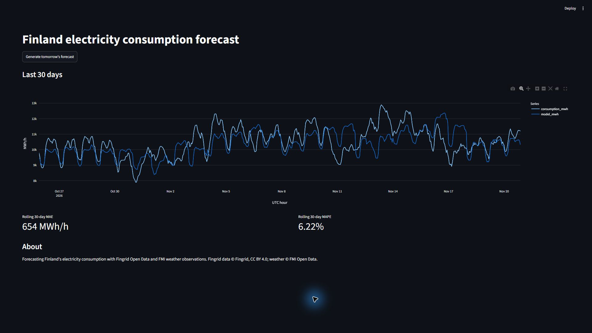
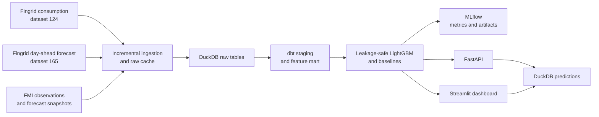

# Finland Grid Forecast

Day-ahead forecasting for Finland’s hourly electricity consumption using Fingrid and FMI open data. **Dashboard:** not publicly deployed yet; [view the screenshot](reports/dashboard.png) or run it locally using the instructions below.



## Results

12-month holdout beginning 2025-11-21 (hourly target delivery dates; 13:00 Helsinki forecast origins).

| Model | MAE | RMSE | MAPE |
|---|---:|---:|---:|
| Leakage-safe LightGBM | 486.9 | 665.3 | 4.58% |
| Seasonal naive | 681.7 | 915.5 | 6.57% |
| Fingrid published forecast | **327.3** | **425.3** | **3.24%** |
| Actual-weather oracle scenario (upper bound) | 421.7 | 551.7 | 4.05% |
| Fingrid residual correction (separate experiment) | 317.7 | 411.6 | 3.17% |

The leakage-safe LightGBM remains behind raw Fingrid: it uses load history, calendar values, and only weather available at issue time, while Fingrid uses its own weather forecasts and operational forecasting process. The separate residual correction did not worsen MAE, RMSE, or MAPE on the final six-month pre-holdout validation window (229.4 / 292.7 / 2.59% raw vs. 223.4 / 285.2 / 2.54% corrected). On the frozen holdout it scored 317.7 / 411.6 / 3.17%, compared with raw Fingrid’s 327.3 / 425.3 / 3.24%; this gain is not a guarantee of future improvement. The oracle uses actual target-day weather and is not deployable; its 13.4% MAE reduction is an upper-bound scenario, not a promise of forecast-weather performance. See [the full backtest](reports/backtest.md) for methodology, validation results, error breakdowns, and limits.

## Architecture



## Run it

Use Python 3.11 or newer. Install the project and development tools, then create `.env` from the example and add your Fingrid Open Data API key:

```sh
make install
cp .env.example .env
```

Set this value in `.env`:

```dotenv
FINGRID_API_KEY=your-fingrid-api-key-here
```

The key is sent in the `x-api-key` request header. Do not commit `.env`.

Common commands:

```sh
make ingest            # ingest Fingrid consumption and FMI observations
make forecast-weather  # save an FMI next-day forecast snapshot
make transform         # build dbt models and marts.features
make train             # train the saved model
make backtest          # write reports/backtest.md and plots
make serve             # run the FastAPI service
make dashboard         # run the Streamlit dashboard
make lint              # run Ruff checks and formatting checks
make test              # run pytest
```

Run both services with Docker after creating `.env`:

```sh
docker compose up --build
```

The API is available at `http://localhost:8000`, and the dashboard at `http://localhost:8501`. Docker mounts the local `data/` directory into both services. For local runs, set `GRIDCAST_DATABASE_PATH` to use a different DuckDB file.

For a populated local warehouse, run `make ingest`, `make transform`, and `make train` before starting the services.

## Design decisions and what didn’t work

- Store timestamps in UTC and convert to Europe/Helsinki for calendar features and display. Forecast examples use only information available at the 13:00 Helsinki issue time; future target-relative rolling values are excluded.
- The consumption backfill spans 2023-11-20 19:00 UTC through 2026-11-20 19:00 UTC and contains 104,831 Fingrid rows and 26,305 hourly FMI observations for each of five places; an immediate repeat downloaded zero new pages or FMI responses. Dataset 165 contributes 134,625 records from 2023-11-20 19:00 UTC through 2026-11-22 17:15 UTC; its resolution is five minutes before 2024-04-21 and 15 minutes afterward.
- Population weights use Statistics Finland’s 2025 municipal counts, and Finnish holidays are generated through 2040. The dashboard compares tomorrow’s model forecast with Fingrid’s dataset 165, charts the last 30 days, and reports rolling MAE/MAPE when matching predictions exist.
- One consumption hour is missing (2024-06-03 08:00 UTC). The feature mart carries forward the last known target and marks it with `consumption_imputed`; it does not use a future value.
- The leakage-safe LightGBM did not beat Fingrid. Fingrid publishes its next-day dataset 165 forecast at 12:00, ahead of this model’s 13:00 issue time. FMI does not retain a historical forecast archive, so daily forecast snapshots are saved for future live predictions. The actual-weather oracle is an upper-bound scenario, not an available forecast input.

## Data credits

- Fingrid Open Data, electricity consumption dataset 124 and forecast dataset 165. Fingrid data is licensed under [CC BY 4.0](https://creativecommons.org/licenses/by/4.0/). Sources: [dataset 124](https://data.fingrid.fi/en/datasets/124), [dataset 165](https://data.fingrid.fi/en/datasets/165).
- Finnish Meteorological Institute Open Data observations and forecasts: [FMI Open Data WFS manual](https://en.ilmatieteenlaitos.fi/open-data-manual-fmi-wfs-services).
