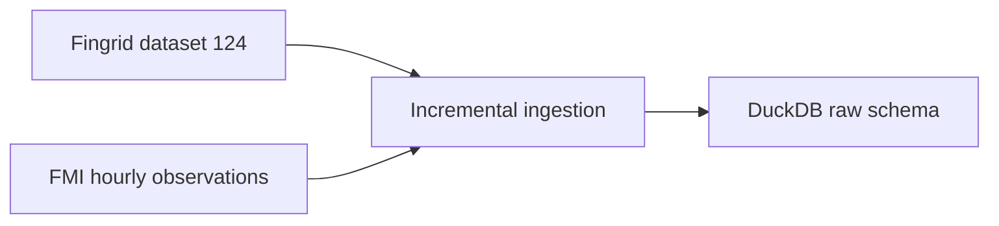

# Finland Grid Forecast

An end-to-end project for forecasting Finland's hourly electricity consumption with Fingrid and FMI open data. The API and dashboard are available locally; measured results below come from a 12-month holdout.

## Results

12-month holdout beginning 2025-11-20 (hourly targets; 13:00 Helsinki forecast origins).

| Model | MAE | RMSE | MAPE |
|---|---:|---:|---:|
| Leakage-safe LightGBM | 486.9 | 665.3 | 4.58% |
| Seasonal naive | 681.7 | 915.5 | 6.57% |
| Fingrid published forecast | **327.3** | **425.3** | **3.24%** |
| Actual-weather oracle scenario (upper bound) | 421.7 | 551.7 | 4.05% |
| Fingrid residual correction (separate experiment) | 388.8 | 485.4 | 3.85% |

Fingrid remains more accurate. The oracle uses actual target-day weather and is not deployable; it shows a 13.4% MAE reduction in this upper-bound scenario. Actual weather is not a guarantee of forecast-weather performance. The correction experiment still trails Fingrid and was calibrated on only 122 pre-holdout hours. See [the full backtest](reports/backtest.md) for methodology, error breakdowns, and limitations.

## M1 ingestion snapshot

The backfill covers 2023-11-20 19:00 UTC through 2026-11-20 19:00 UTC. DuckDB contains 104,831 Fingrid consumption records and 26,305 hourly FMI observations for each of the five configured places. An immediate repeat reported zero newly downloaded Fingrid pages and FMI responses.

## M1 architecture



## M2 transformations

The dbt project cleans and deduplicates the Fingrid 15-minute rows, rolls them
up to UTC hours, stages FMI observations, and builds `marts.features`. The mart
includes consumption lags (24, 48, and 168 hours), trailing 24- and 168-hour
means, Helsinki calendar fields, Finnish public holidays, population-weighted
temperature observed 24 hours before each feature hour, and heating degree
hours. The weather lag is available at forecast time and avoids using future
observations. Population weights use Statistics Finland's 2025 municipal
population counts. Finnish holidays are generated through 2040 by the `holidays`
package when transforms run.

The raw history contains one missing consumption hour (2024-06-03 08:00 UTC).
The feature mart carries forward the last known target for that one hour and
sets `consumption_imputed` so downstream work can identify it. No future value
is used for this fill. The DST feature identifies Helsinki's UTC+3 hours; all
model timestamps remain UTC.

Run `make transform` to generate the dbt seeds and build the staging and mart
models. Run `dbt test --project-dir dbt --profiles-dir dbt` for the data checks.
Set `GRIDCAST_DATABASE_PATH` to override the default `data/gridcast.duckdb`.

## Run ingestion

Use Python 3.11 or newer. Install the project and development tools, then copy `.env.example` to `.env` and set `FINGRID_API_KEY` to a registered Fingrid Open Data API key.

```sh
make install
make ingest
```

`make ingest` backfills at least three years of consumption and hourly weather observations into `data/gridcast.duckdb`. Raw HTTP responses are cached under `data/raw_cache`. A later run requests only time ranges that are not already recorded as successfully ingested. Fingrid requests use the `x-api-key` header and are paced to the API's published rate limit.

Useful checks:

```sh
make lint
make test
```

The local pre-commit hooks use the same Ruff checks. Install them with `pre-commit install` after `make install`.

## Design decisions and current limits

- All stored timestamps are timezone-aware UTC timestamps. Helsinki time is reserved for calendar features and display work in later milestones.
- Fingrid dataset 124 is the official consumption dataset. Its API coverage is recorded separately from returned measurements so empty periods are not repeatedly downloaded.
- FMI observations use the official `fmi::observations::weather::timevaluepair` WFS stored query with hourly `t2m` observations for Helsinki, Tampere, Turku, Oulu, and Jyväskylä. Requests cover one week (the service limit) and ask for all five places together.
- M3 uses hourly origin-safe examples: each 13:00 Helsinki origin predicts the following local day using the prior week's same-hour consumption, the 48-hour lag, 24- and 168-hour consumption means known at issue time, target calendar fields, and weather information available at issue time. Target-relative rolling features are not used for the 24-hour forecast because late forecast hours would expose future observations. The 13:00 issue time follows Fingrid's daily forecast publication.
- Fingrid's official next-day consumption forecast is dataset 165 (catalogue: https://data.fingrid.fi/en/datasets/165). The backtest compares forecast rows aligned by UTC delivery hour.
- FMI does not retain an archive of past forecast runs. The daily `fmi-forecast.yml` job saves forecast vintages; `make forecast-weather` runs the same snapshot job locally. The API reads the latest saved FMI forecast for target hours when it is present, and otherwise uses issue-time observations. The job writes to `GRIDCAST_DATABASE_PATH` (default `data/gridcast.duckdb`), which must be the database shared with the API for the API to use those snapshots.
- Fingrid's dataset 165 is published daily at 12:00 Helsinki time for the next day, so M3's 13:00 origin can compare against it and train a separate error-correction experiment. The correction did not beat Fingrid in this holdout. See `reports/backtest.md` for measured results and limits.

## M4 API and dashboard

Run `make serve` for the FastAPI service (`/health`, `/forecast?date=YYYY-MM-DD`, `/metrics`) and `make dashboard` for Streamlit. The dashboard's Generate button and the API's next-day forecast endpoint use the saved M3 model. Both read and write `forecast_predictions` in the same DuckDB file; set `GRIDCAST_DATABASE_PATH` to change it. Forecast request dates are Helsinki calendar dates, while returned timestamps and stored keys are UTC.

Run `make train` once to create the model artifact, then start both services with `docker compose up --build`; the local `data/` directory is mounted into both containers. Set `FINGRID_API_KEY` in `.env` for forecast comparison refreshes. The dashboard compares tomorrow's model forecast with Fingrid's dataset 165, plots the last 30 days of actual and stored forecast values, and reports rolling MAE/MAPE when matching predictions exist. It credits Fingrid and FMI on the page.

## Data credits

- Fingrid Open Data, electricity consumption dataset 124, licensed under CC BY 4.0. Source: [Fingrid Open Data](https://data.fingrid.fi/en/datasets/124).
- Finnish Meteorological Institute (FMI) Open Data weather observations. Source: [FMI Open Data WFS manual](https://en.ilmatieteenlaitos.fi/open-data-manual-fmi-wfs-services).
