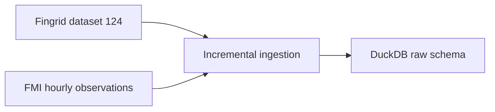

# Finland Grid Forecast

An end-to-end project for forecasting Finland's hourly electricity consumption. The live dashboard and measured forecast results are planned for later milestones and are not available yet.

## Results

No forecast has been evaluated yet; results will be reported after the backtesting milestone.

| Model | MAE | RMSE | MAPE |
|---|---:|---:|---:|
| Forecast model | — | — | — |
| Seasonal naive | — | — | — |
| Fingrid published forecast | — | — | — |

## M1 ingestion snapshot

The backfill covers 2023-11-20 19:00 UTC through 2026-11-20 19:00 UTC. DuckDB contains 104,831 Fingrid consumption records and 26,305 hourly FMI observations for each of the five configured places. An immediate repeat reported zero newly downloaded Fingrid pages and FMI responses.

## M1 architecture



## M2 transformations

The dbt project cleans and deduplicates the Fingrid 15-minute rows, rolls them
up to UTC hours, stages FMI observations, and builds `marts.features`. The mart
includes consumption lags (24, 48, and 168 hours), trailing 24- and 168-hour
means, Helsinki calendar fields, Finnish public holidays, population-weighted
temperature observed 24 hours before each feature hour, and heating degree
hours. The weather lag is available at forecast time and avoids using future
observations. Population weights use Statistics Finland's 2025 municipal
population counts. Finnish holidays are generated through 2040 by the `holidays`
package when transforms run.

The raw history contains one missing consumption hour (2024-06-03 08:00 UTC).
The feature mart carries forward the last known target for that one hour and
sets `consumption_imputed` so downstream work can identify it. No future value
is used for this fill. The DST feature identifies Helsinki's UTC+3 hours; all
model timestamps remain UTC.

Run `make transform` to generate the dbt seeds and build the staging and mart
models. Run `dbt test --project-dir dbt --profiles-dir dbt` for the data checks.
Set `GRIDCAST_DATABASE_PATH` to override the default `data/gridcast.duckdb`.

## Run ingestion

Use Python 3.11 or newer. Install the project and development tools, then copy `.env.example` to `.env` and set `FINGRID_API_KEY` to a registered Fingrid Open Data API key.

```sh
make install
make ingest
```

`make ingest` backfills at least three years of consumption and hourly weather observations into `data/gridcast.duckdb`. Raw HTTP responses are cached under `data/raw_cache`. A later run requests only time ranges that are not already recorded as successfully ingested. Fingrid requests use the `x-api-key` header and are paced to the API's published rate limit.

Useful checks:

```sh
make lint
make test
```

The local pre-commit hooks use the same Ruff checks. Install them with `pre-commit install` after `make install`.

## Design decisions and current limits

- All stored timestamps are timezone-aware UTC timestamps. Helsinki time is reserved for calendar features and display work in later milestones.
- Fingrid dataset 124 is the official consumption dataset. Its API coverage is recorded separately from returned measurements so empty periods are not repeatedly downloaded.
- FMI observations use the official `fmi::observations::weather::timevaluepair` WFS stored query with hourly `t2m` observations for Helsinki, Tampere, Turku, Oulu, and Jyväskylä. Requests cover one week (the service limit) and ask for all five places together.
- Transformations, forecasting, serving, and the dashboard have not been started; they belong to later milestones.

## Data credits

- Fingrid Open Data, electricity consumption dataset 124, licensed under CC BY 4.0. Source: [Fingrid Open Data](https://data.fingrid.fi/en/datasets/124).
- Finnish Meteorological Institute (FMI) Open Data weather observations. Source: [FMI Open Data WFS manual](https://en.ilmatieteenlaitos.fi/open-data-manual-fmi-wfs-services).
